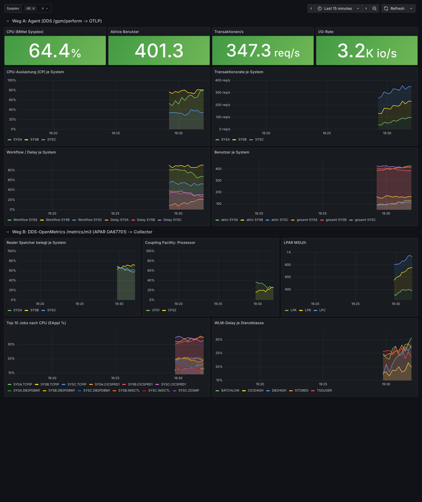

# z/OS-Leistungsdaten in OpenTelemetry (RMF Data Portal)

Prototyp: RMF-Monitor-III-Daten aus dem **RMF Data Portal / Distributed Data Server (DDS)**
als **OpenTelemetry-Metriken** bereitstellen und in Grafana anzeigen. Lokal komplett
lauffähig mit einem simulierten DDS; für ein echtes System nur URL und Zugang eintragen.



## OpenTelemetry in fünf Sätzen

- **OpenTelemetry (OTel)** ist ein herstellerneutraler Standard (CNCF) dafür, wie Programme und
  Systeme ihre Messdaten abliefern: **Metriken** (Zahlen über die Zeit), **Traces**
  (Weg einer Anfrage durch mehrere Systeme) und **Logs**.
- Das Übertragungsprotokoll heißt **OTLP** (HTTP oder gRPC). Jedes moderne Monitoring-Produkt
  nimmt OTLP an: Prometheus, Grafana, Dynatrace, Datadog, Splunk, Elastic, New Relic, Instana ...
- Zentrales Bauteil ist der **OpenTelemetry Collector**: Er nimmt Daten an (receiver),
  bereitet sie auf (processor) und verteilt sie an beliebige Ziele (exporter).
- Wer einmal OTLP liefert, muss sich nicht mehr für ein Monitoring-Produkt entscheiden –
  das Ziel ist eine Zeile in der Collector-Konfiguration.
- Für den Mainframe heißt das: z/OS erscheint in denselben Dashboards und Alarmen wie die
  verteilte Welt (Kubernetes, Cloud, Datenbanken), statt in einer eigenen Insel.

## Architektur

```
 z/OS                                        Linux/Windows/Cloud (oder z/OS UNIX)
 ─────────────────────────────               ────────────────────────────────────────────────
 RMF Monitor III                                                       ┌─▶ Prometheus ─▶ Grafana
   │                                         Weg A                     │
 DDS (GPMSERVE, Port 8803)  ── /gpm/perform ──▶ rmf_otel_agent.py ─OTLP─┤
   │                                                                   │   OpenTelemetry
   └──────────────────────── /metrics/m3 ────────────────────────────▶ Collector ─▶ Dynatrace,
                             (OpenMetrics,   Weg B: Collector scrapt     │            Splunk, ...
                              APAR OA67701)  direkt (keine eigene SW)    └─▶ (beliebig viele Ziele)
```

**Weg B – ohne eigene Software (empfohlen, wenn verfügbar).** Seit APAR **OA67701**
(RMF 3.1 und 3.2) bietet der DDS den Endpunkt `/metrics/m3` im OpenMetrics-Format. Der
OpenTelemetry Collector holt ihn mit seinem `prometheus`-Receiver ab. Welche Werte erscheinen,
steuert die DDS-Konfiguration **GPMOMC** (oder Parameter `groups` am Endpunkt).
Metriknamen wie `mvs_cf_processor_utilization_percent`, `mvs_job_total_eappl_percent`,
`mvs_wlm_group_delay_percent` (Labels `sysplex`, `sysname`, `job_name` ...).

**Weg A – Agent `rmf_otel_agent.py`.** Für Systeme ohne OA67701 oder für Monitor-III-Werte,
die nicht in GPMOMC stehen: Der Agent fragt beliebige Monitor-III-Metriken über die klassische
DDS-Schnittstelle ab (`/gpm/perform?resource=,,SYSPLEX&id=8D0450`, JSON oder XML) und schickt
sie per OTLP. Er braucht nur die Python-Standardbibliothek und läuft damit auch direkt unter
**z/OS UNIX** (IBM Open Enterprise SDK for Python) – dann ist z/OS selbst der Absender.

Beide Wege lassen sich kombinieren; das Demo macht genau das.

## Demo starten (ohne z/OS)

Voraussetzung: Docker mit `docker compose`.

```sh
docker compose up -d
./fetch-ibm-dashboards.sh      # optional: IBMs RMF-Beispieldashboards dazu
```

Dann <http://localhost:3000> öffnen (anonymer Zugang, Ordner **z/OS**):

- **z/OS RMF (OpenTelemetry)** – eigenes Dashboard: oben Werte vom Agenten (CPU, Benutzer,
  Transaktionen, Workflow/Delay, I/O je System), unten Werte von `/metrics/m3`
  (realer Speicher, Coupling Facility, MSU je LPAR, Top-Jobs, WLM-Delays).
- **IBM-Dashboards** (nach `fetch-ibm-dashboards.sh`): z/OS Central/Common Storage,
  Coupling Facility, MSU Capacity, Usage by Job, WLM Workload Delays. Sie laufen unverändert,
  weil die Metriknamen durch den Collector erhalten bleiben.

Bausteine im Compose:

| Dienst | Aufgabe |
|---|---|
| `mock-dds` | simulierter DDS (`mock_dds.py`): Sysplex PLEX1, Systeme SYSA/SYSB/SYSC, erfundene Werte |
| `rmf-agent` | `rmf_otel_agent.py` mit `demo/agent.demo.json` (Weg A) |
| `otel-collector` | OpenTelemetry Collector contrib 0.139: OTLP-Empfang + Scrape `/metrics/m3` (Weg B) |
| `prometheus` | Prometheus 3.7, nimmt OTLP direkt an (`--web.enable-otlp-receiver`) |
| `grafana` | Grafana 12.2 mit vorkonfigurierter Datenquelle und Dashboards |

Prüfen ohne Browser: `curl 'localhost:9090/api/v1/query?query=rmf_cpu_utilization_percent'`.
Beenden: `docker compose down`.

## An ein echtes z/OS anschließen

1. **DDS erreichbar?** `curl -u DDSUSER 'http://<dds>:8803/gpm/perform?resource=,,SYSPLEX&id=8D0D60'`
   (Benutzer an Systemen ohne DDS-Anmeldung weglassen; mit AT-TLS `https`).
   `/metrics/m3` testen: `curl -u DDSUSER http://<dds>:8803/metrics/m3 | head`.
2. **Weg B:** in `collector/otel-collector.yaml` das Ziel `mock-dds:8803` durch den DDS ersetzen,
   `scrape_interval` = Monitor-III-MINTIME (meist `100s`), bei Bedarf `scheme: https` und
   `basic_auth` mit `password_file` einkommentieren.
3. **Weg A:** `agent.example.json` kopieren, `dds.url`/`dds.user` setzen, Kennwort per
   Umgebungsvariable `RMF_DDS_PASSWORD` (nie in die Datei). Metrik-IDs am eigenen DDS prüfen:
   `http://<dds>:8803/gpm/index` bzw. Metrikbrowser des IBM-RMF-Grafana-Plugins.
   ```sh
   RMF_DDS_PASSWORD=... python3 rmf_otel_agent.py --config agent.json --once --dry-run   # Probe
   RMF_DDS_PASSWORD=... python3 rmf_otel_agent.py --config agent.json                    # Betrieb
   ```
4. **Weitere Ziele** (Dynatrace, Splunk, Elastic, Grafana Cloud ...) als `otlphttp/...`-Exporter
   in `collector/otel-collector.yaml` eintragen – an z/OS ändert sich nichts.

### Agent direkt unter z/OS UNIX

```sh
# Python (IBM Open Enterprise SDK for Python) im PATH; Dateien als UTF-8/ASCII markieren
chtag -tc 819 rmf_otel_agent.py agent.json
export RMF_DDS_PASSWORD=...           # oder DDS ohne Anmeldung auf localhost
python3 rmf_otel_agent.py --config agent.json
```

Als Dauerläufer z. B. per BPXBATCH-Started-Task. Der DDS ist dann `http://localhost:8803`;
der OTLP-Endpunkt ist der Collector außerhalb (Firewall: ausgehend TCP 4318).

## Konfiguration des Agenten

```json
{
  "dds":   {"url": "http://ddshost:8803", "user": "DDSUSER", "insecure": false},
  "otlp":  {"endpoint": "http://collector:4318", "headers": {}},
  "interval": 100,
  "resource": {"zos.sysplex.name": "PLEX1"},
  "metrics": [
    {"id": "8D0450", "resource": ",,SYSPLEX", "name": "rmf.cpu.utilization",
     "unit": "%", "row_attribute": "zos.system.name"}
  ]
}
```

- `metrics[].resource`: DDS-Ressource, z. B. `,,SYSPLEX` oder `,SYSA,MVS_IMAGE`.
- `name`/`unit`: OTel-Name und Einheit; ohne `name` wird er aus der DDS-Beschreibung gebildet.
- `row_attribute`: Attribut für die Zeilennamen von Listenmetriken („... by MVS image“).
- Umgebungsvariablen überschreiben: `RMF_DDS_URL`, `RMF_DDS_USER`, `RMF_DDS_PASSWORD`,
  `OTEL_EXPORTER_OTLP_ENDPOINT`.
- Der Agent meldet jedes Monitor-III-Intervall genau einmal (Zeitstempel = `utcEnd` des DDS);
  Werte wie `NaN`, `Deact` und `*NoData*`-Zeilen werden übersprungen.

In Prometheus heißen die Metriken nach OTel-Regeln z. B. `rmf_cpu_utilization_percent`,
`rmf_transaction_rate_per_second` (Label `zos_system_name`, `zos_sysplex_name`).

## Tests

```sh
python3 -m unittest -v test_agent.py
```

Umsetzung DDS-Report -> OTLP, Fehlerfälle, XML-Antwort, und Ende-zu-Ende gegen `mock_dds.py`
(JSON- und XML-Modus) mit einem eingebauten OTLP-Empfänger. Das Demo-Compose wurde
vollständig durchgespielt (alle Dashboard-Abfragen liefern Daten).

## Stand und Grenzen

- **Nicht gegen einen echten DDS getestet.** JSON-Format und Endpunkte stammen aus IBMs
  RMF-Grafana-Plugin (Quellcode, github.com/IBM/RMF); das XML-Format ist nachgebildet.
  Erster Schritt am eigenen System: Punkt 1 oben.
- Die Metrik-IDs in `agent.example.json` stammen aus dem Metrikkatalog des IBM-Plugins;
  bitte am eigenen DDS bestätigen.
- Nur Metriken. Mögliche Ausbaustufen:
  - **Traces aus Anwendungen:** z. B. Programmaufrufe (CALL) als Spans melden –
    ein Batchlauf oder eine Transaktion wird dann im selben Trace-Werkzeug sichtbar wie der
    aufrufende Java-/Cloud-Dienst.
  - **Logs:** Joblog-/SYSLOG-Meldungen als OTel-Logs.
  - **SMF-Daten** (Typ 30/70-79) für Abrechnungs- und Langzeitsicht.
- IBM bietet eigene Wege: RMF-Grafana-Plugin (direkt auf den DDS, ohne OTel) und kommerziell
  z. B. IBM Z Common Data Provider / Z Operational Log and Data Analytics. Dieser Prototyp
  ist die herstellerneutrale, kostenlose Variante.
